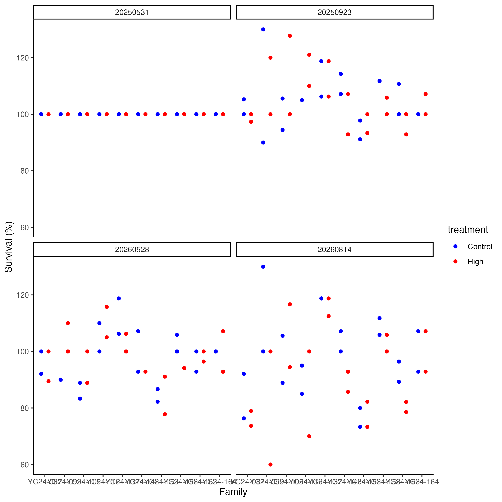
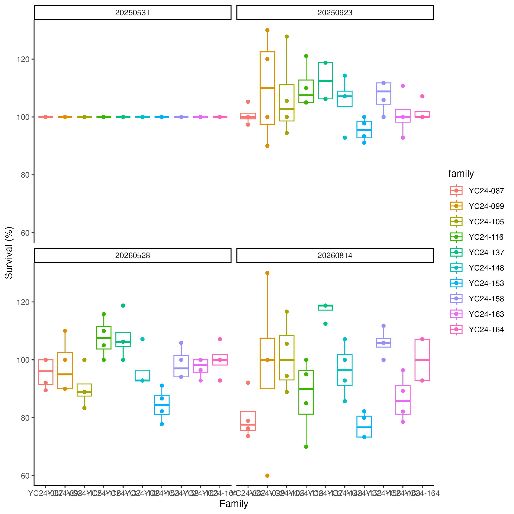
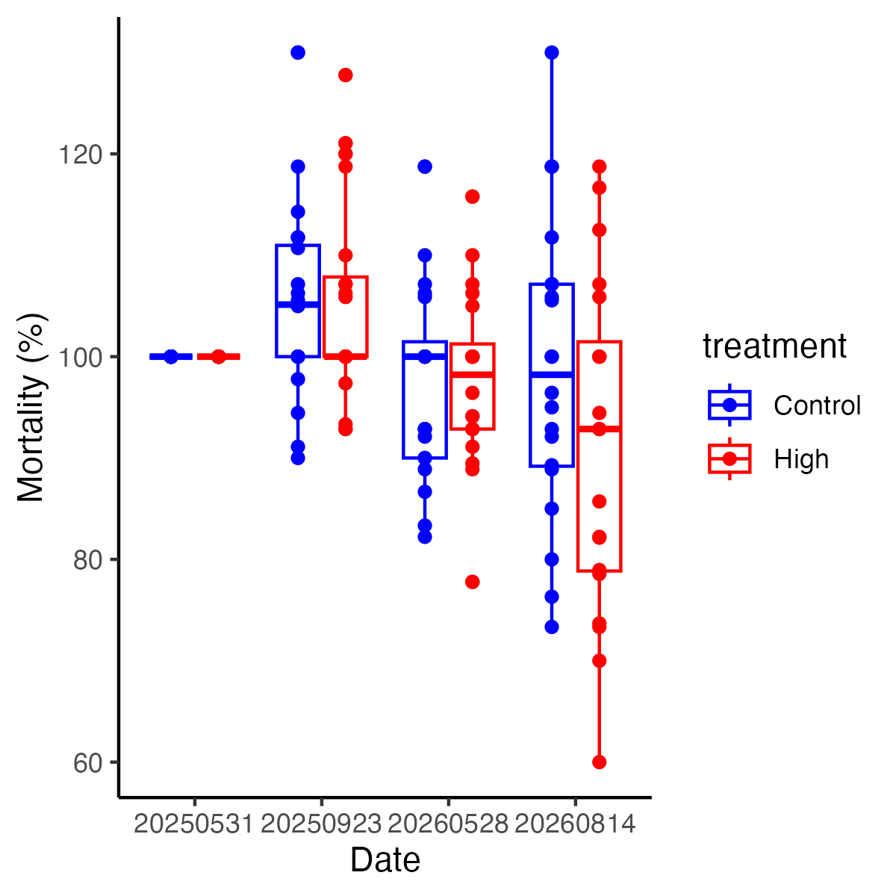
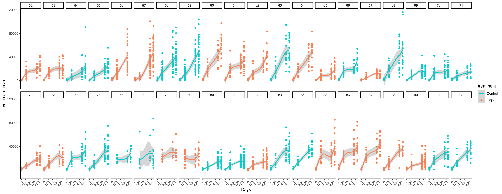
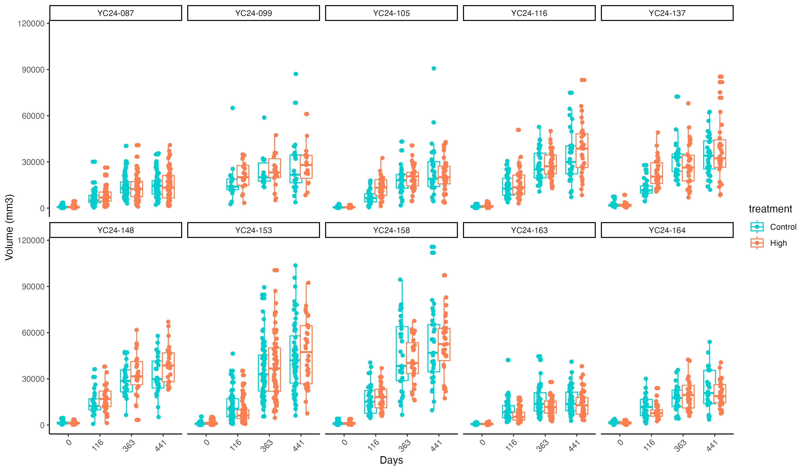
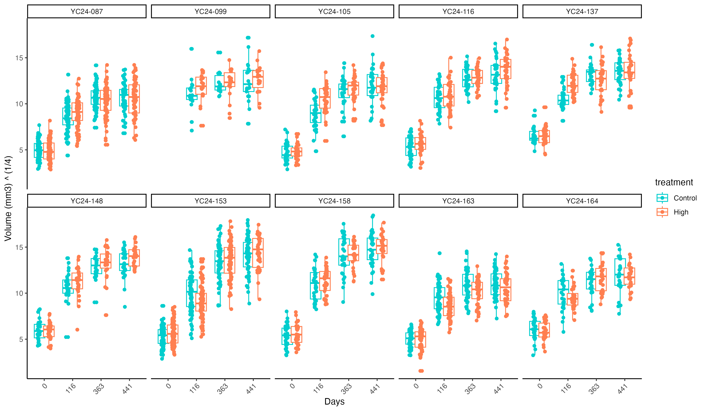

  

# Overview 

Over the last few weeks students in the lab have been analyzing images to measure oyster growth from the Manchester Hardening experiment. This post shows my initial analysis of those data.  

All data are on [GitHub here](https://github.com/RobertsLab/manchester-hardening/tree/main/data/).   

Scripts to analyse these data are [also on GitHub here](https://github.com/RobertsLab/manchester-hardening/blob/main/scripts/).  

Growth and survival were measured on the following time points:  

1. 2025-05-31: initial measurement following 2 week hardening   
2. 2025-09-23: growth and survival after first summer  
3. 2026-05-28: growth and survival after first full year  
4. 2026-08-14: growth and survival after second summer  

For each family, there are two tags of Control oysters (no hardening) and two tags of High oysters (hardening treatment) with four total tags per family. There are 10 total families.  

## Survival analysis 

Survival data is available [on GitHub here](https://github.com/RobertsLab/manchester-hardening/blob/main/data/mortality.xlsx).    

We counted live oysters at each time point or obtained counts from images. At each time point after the start of the deployment, we have multiple tags with more oysters than were present at the start. I looked back at all of my notes and images and the counts are accurate. We must have had some recruitment into the bags perhaps. I need to look back and see if we can see a clear size difference to indicate potential recruits that shouldn't be included in survival.  

I ran a model with family and treatment as main effects, but not the interaction because we only have n=2 per treatment x family combination. We have n=4 per family and n=20 per treatment total.  

Here is the full dataset - note the 100+% survival observations.  

   

Here is survival by family.  

  

And finally, here is survival by treatment.  

  

Statistical results show an effect of family, but not treatment.  

```
model2<-data%>%
  
  lmer(survival~treatment+family+as.factor(date)+treatment:as.factor(date)+family:as.factor(date)+ (1|cage) + (1|tank), data=.)

anova(model2)

qqPlot(residuals(model2))

emm<-emmeans(model2, ~family | date)
pairs(emm)
cld(emm)
```

There is an effect of family but not treatment.  

```
Type II Analysis of Variance Table with Satterthwaite's method
                          Sum Sq Mean Sq NumDF DenDF F value    Pr(>F)    
treatment                   25.2   25.20     1     2  0.4012 0.5912413    
family                    4174.7  463.86     9   114  7.3844 1.977e-08 ***
as.factor(date)           2241.5  747.17     3   114 11.8945 7.799e-07 ***
treatment:as.factor(date)  421.4  140.48     3   114  2.2364 0.0878096 .  
family:as.factor(date)    4001.5  148.20    27   114  2.3593 0.0008999 ***
```

Post hoc results show that survival wasn't different after the first summer. Survival begins to differentiate between families a little by one year post deployment, but differentiate much more at the end of the deployment (end of the second summer).  

```
date = 20250531:
 family   emmean   SE   df lower.CL upper.CL .group
 YC24-163  100.0 4.17 72.4     91.7    108.3  1    
 YC24-153  100.0 4.17 72.4     91.7    108.3  1    
 YC24-116  100.0 4.17 72.4     91.7    108.3  1    
 YC24-164  100.0 4.17 72.4     91.7    108.3  1    
 YC24-099  100.0 4.17 72.4     91.7    108.3  1    
 YC24-137  100.0 4.17 72.4     91.7    108.3  1    
 YC24-148  100.0 4.17 72.4     91.7    108.3  1    
 YC24-105  100.0 4.17 72.4     91.7    108.3  1    
 YC24-158  100.0 4.17 72.4     91.7    108.3  1    
 YC24-087  100.0 4.17 72.4     91.7    108.3  1    

date = 20250923:
 family   emmean   SE   df lower.CL upper.CL .group
 YC24-153   95.6 4.17 72.4     87.2    103.9  1    
 YC24-087  100.7 4.17 72.4     92.4    109.0  1    
 YC24-163  100.9 4.17 72.4     92.6    109.2  1    
 YC24-164  101.8 4.17 72.4     93.5    110.1  1    
 YC24-148  105.4 4.17 72.4     97.1    113.7  1    
 YC24-105  106.9 4.17 72.4     98.6    115.3  1    
 YC24-158  107.4 4.17 72.4     99.0    115.7  1    
 YC24-099  110.0 4.17 72.4    101.7    118.3  1    
 YC24-116  110.3 4.17 72.4    102.0    118.6  1    
 YC24-137  112.5 4.17 72.4    104.2    120.8  1    

date = 20260528:
 family   emmean   SE   df lower.CL upper.CL .group
 YC24-153   84.4 4.17 72.4     76.1     92.8  1    
 YC24-105   90.3 4.17 72.4     82.0     98.6  12   
 YC24-087   95.4 4.17 72.4     87.1    103.7  12   
 YC24-148   96.4 4.17 72.4     88.1    104.7  12   
 YC24-163   97.3 4.17 72.4     89.0    105.6  12   
 YC24-099   97.5 4.17 72.4     89.2    105.8  12   
 YC24-158   98.5 4.17 72.4     90.2    106.8  12   
 YC24-164  100.0 4.17 72.4     91.7    108.3  12   
 YC24-116  107.7 4.17 72.4     99.4    116.0   2   
 YC24-137  107.8 4.17 72.4     99.5    116.1   2   

date = 20260814:
 family   emmean   SE   df lower.CL upper.CL .group
 YC24-153   77.2 4.17 72.4     68.9     85.5  1    
 YC24-087   80.3 4.17 72.4     72.0     88.6  12   
 YC24-163   86.6 4.17 72.4     78.3     94.9  123  
 YC24-116   87.5 4.17 72.4     79.2     95.8  123  
 YC24-148   96.4 4.17 72.4     88.1    104.7   234 
 YC24-099   97.5 4.17 72.4     89.2    105.8   234 
 YC24-164  100.0 4.17 72.4     91.7    108.3    345
 YC24-105  101.4 4.17 72.4     93.1    109.7    345
 YC24-158  105.9 4.17 72.4     97.6    114.2     45
 YC24-137  117.2 4.17 72.4    108.9    125.5      5
```

## Growth analysis 

Growth data is available [on GitHub here](https://github.com/RobertsLab/manchester-hardening/blob/main/data/size/growth.csv).  

At each time point, we photographed oysters and then analyzed size in ImageJ. Christina, Maddy, and Grace were a huge help in analyzing the images!  

For this dataset, I am analyzing size over time so that I can use all observations. I did not collapse growth to an average rate for each tag, because that will severely limit our sample size.  

Oyster volume was analyzed using the following model:  

```
calc_oyster_volume <- function(length_mm, width_mm, k = 0.21) {
  k * length_mm * (width_mm^2)
}

data$volume.mm3 <- calc_oyster_volume(data$length.mm, data$width.mm)
```

I analyzed size over time with treatment, time, and family as main effects and tag and hardening tank as random effects. Time is shown as days post deployment.   

Here are the size data for all of the replicate tags.  

  

Here are the size data summarized by family and treatment.  

  

After running the models (below) I conducted a quarter-root transformation. Here are the data displayed on the same scale as included in the model to compare the results too.  

  

```
model<-data%>%
  
  lmer((volume.mm3)^(1/4) ~ as.factor(days) * family * treatment + (1|tag) + (1|cage), data=.)

summary(model)
anova(model, type=2)

emm <- emmeans(model, ~ as.factor(days) * family * treatment)
pairs(emm, by = c("days", "family"), adjust = "tukey")

qqPlot(residuals(model))
```

```
Type II Analysis of Variance Table with Satterthwaite's method
                                  Sum Sq Mean Sq NumDF   DenDF   F value    Pr(>F)    
as.factor(days)                  25246.4  8415.5     3 3045.25 3766.1173 < 2.2e-16 ***
family                             560.2    62.2     9   15.68   27.8550 5.206e-08 ***
treatment                            0.4     0.4     1    2.21    0.1672    0.7189    
as.factor(days):family            1089.1    41.9    26 3044.29   18.7465 < 2.2e-16 ***
as.factor(days):treatment            6.3     2.1     3 3046.30    0.9408    0.4200    
family:treatment                    13.2     1.5     9   15.70    0.6586    0.7333    
as.factor(days):family:treatment   153.9     5.9    26 3045.06    2.6488 1.142e-05 ***
```

There is a significant interaction between date, family, and treatment.  I then ran a post hoc to determine which family x treatment effects are present.  

- YC24-163 on days 116 P=0.043 (smaller size in treated)    
- YC24-153 on days 116 P=0.041 (smaller size in treated)    
- YC24-137 on days 116 P=0.001 (bigger size in treated)   
- YC24-105 on days 116 P=0.001 (bigger size in treated)   

Day 116 was the September 2025 time point, representing effects of hardening after the first summer of deployment.  

## Assessing family specific effects  

I then looked back at the acute stress survival data [detailed in my past post](https://ahuffmyer.github.io/posts/2026-09-08-manchester-hardening-project-survival-test-results.html). Here are the families of interest.  

Hardening led to the following effects:  

- Family YC-163 lost thermal tolerance and had smaller sizes after the 1st summer after hardening
- Family YC-153 gained thermal tolerance and had smaller sizes after the 1st summer after hardening
- Family YC-137 gained thermal tolerance and had larger sizes after the 1st summer after hardening
- Family YC-116 lost thermal tolerance, no size differences 
- Family YC-105 larger sizes after the 1st summer after hardening 

It is interesting to note that hardening effects are very family specific. In some cases, families that gained thermal tolerance also increased their growth after the 1st summer, while others did the opposite or weren't affected.  


