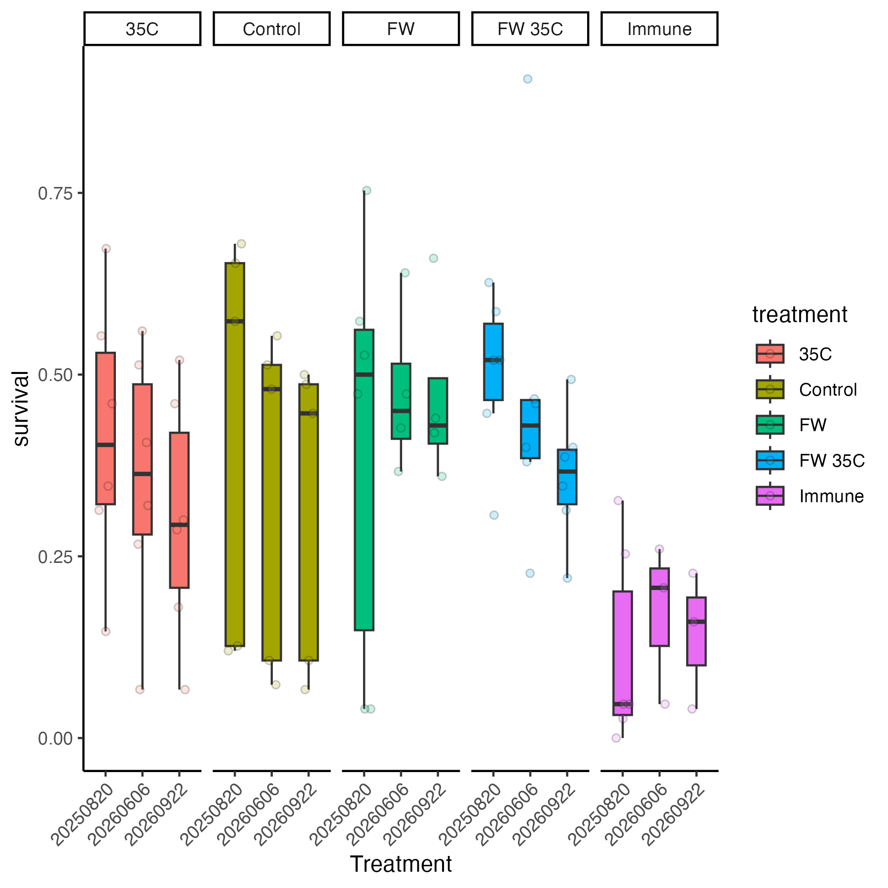
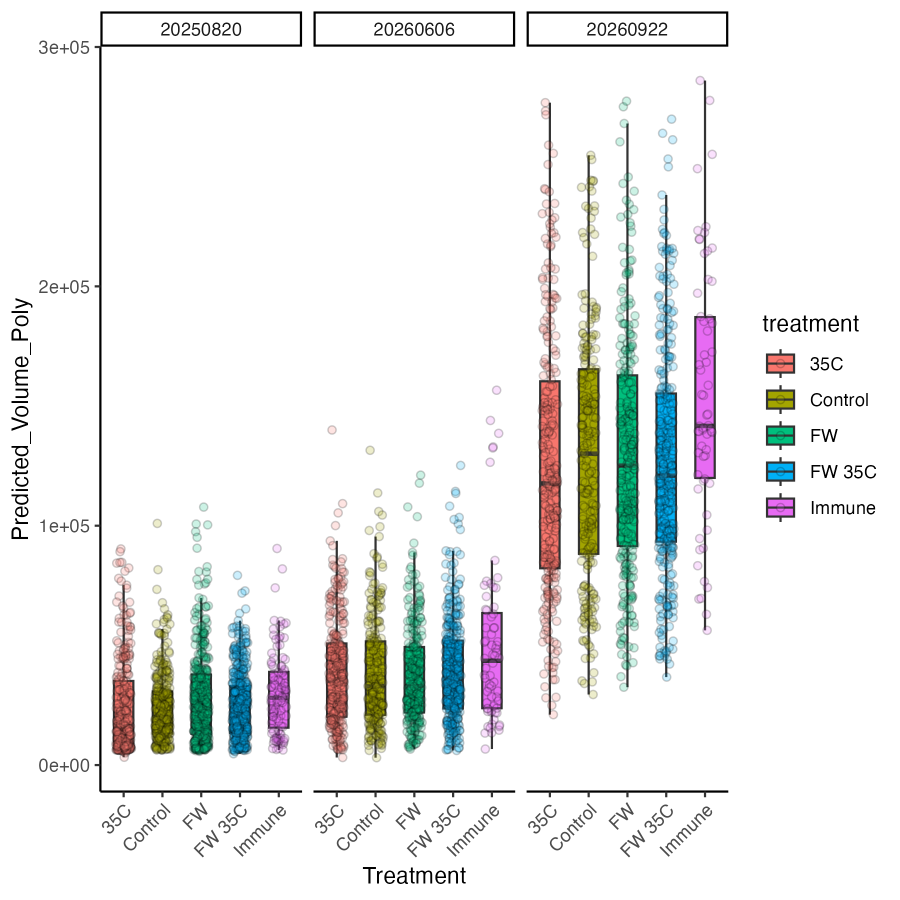
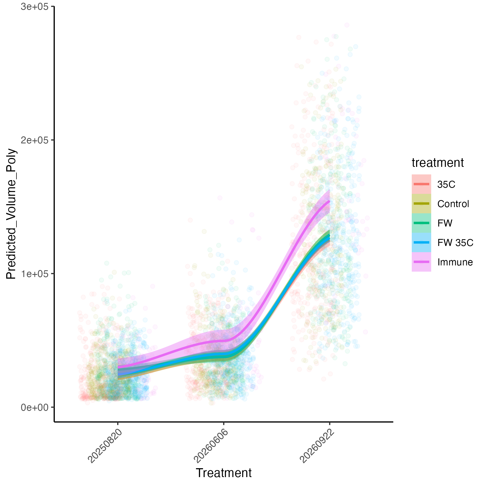
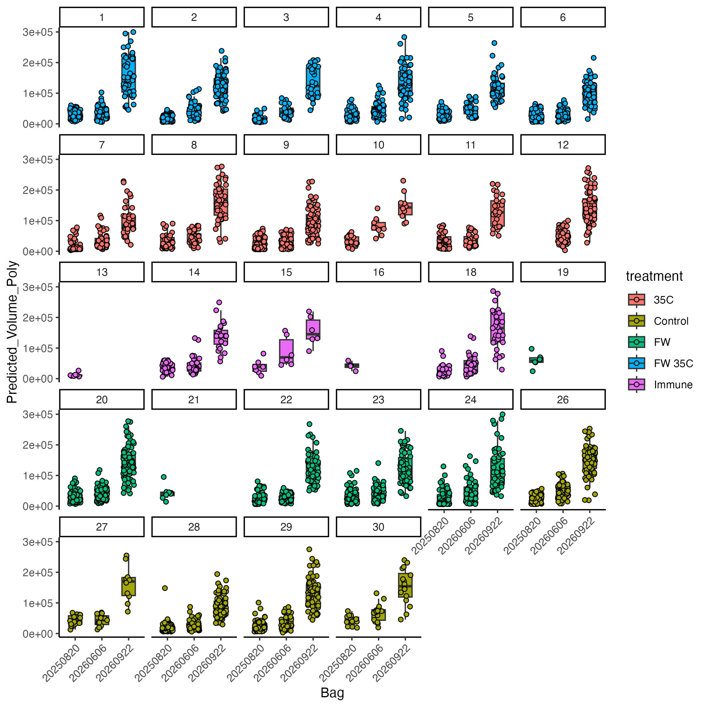

  

# Overview 

Over the last few weeks students in the lab have been analyzing images to measure oyster growth from the 10K Seed Hardening experiment. This post shows my initial analysis of those data.  

All data are on [GitHub here](https://github.com/RobertsLab/10K-seed-Cgigas/).   

Scripts to analyse these data are [also on GitHub here](https://github.com/RobertsLab/10K-seed-Cgigas/scripts/).  

Growth and survival were measured on the following time points:  

1. 2024-10-30: outplant and start of deployment 
2. 2025-08-20: growth and survival after first summer  
3. 2026-06-06: growth and survival after first summer and winter   
4. 2026-09-22: growth and survival after second summer and almost two full years

There are five treatments:  

1. Control
2. 35°C weekly exposure for 2 h 
3. Fresh water weekly exposure for 2 h 
4. Fresh water 35°C weekly exposure for 2 h 
5. Weekly Poly(I:C) immune exposure for 1 h 

## Survival analysis 

Survival data is available [on GitHub here](https://github.com/RobertsLab/10K-seed-Cgigas/blob/main/data/outplant/outplant-survival.csv).    

We counted live oysters at each time point or obtained counts from images. We had issues with bag loss and malfunction/opening during the deployment, especially in some of the PolyIC bags (just by chance they were the same treatment). Survival data should not be relied on statistically due to low sample size and issues with missing bags. But I've included it here to show the data we have available.   

Here is survival by treatment  

  

Note the small sample size in PolyIC treatment and lower overall survival. Survival generally decreases from 100% to 50% in the first year, with another 5-10% loss over the second year. All bags started with 150 oysters.  

## Growth analysis 

Growth data is available [on GitHub here](https://github.com/RobertsLab/10K-seed-Cgigas/blob/main/data/outplant/outplant-growth.csv).  

At each time point, we photographed oysters and then analyzed size in ImageJ. Christina, Maddy, and Grace were a huge help in analyzing the images!  

For this dataset, I am analyzing size over time so that I can use all observations. I did not collapse growth to an average rate for each tag, because that will severely limit our sample size.  

Oyster volume was analyzed using the Goose Point size training data set. It was then fit with a polynomial model.     

```
training_data<-read_csv(file="https://raw.githubusercontent.com/RobertsLab/project-gigas-conditioning/refs/heads/main/data/outplanting/GoosePoint/growth_GoosePoint.csv")%>%
  mutate(date=as.factor(date))%>%
  filter(date %in% c("20240909", "20251009", "20260522"))

training_data$volume <- (4/3) * pi * (training_data$length.mm/2) * (training_data$width.mm/2) * (training_data$depth.mm/2)

poly_model <- lm(volume ~ poly(length.mm, 2) + poly(width.mm, 2) + length.mm:width.mm, data = training_data)

summary(poly_model)
```

I analyzed size over time with treatment as the main effect. Time is shown as date.   

Here are the growth data summarized by treatment.  

 

 

Here is growth for each individual bag.  



I then analyzed growth using a linear mixed model with date and treatment as main effects and bag as a random effect.  

```
model<-lmer(sqrt(Predicted_Volume_Poly) ~ treatment * date + (1|purple.tag), data=data)

summary(model)
anova(model)

qqPlot(residuals(model))
hist(residuals(model))
```

```
Type II Analysis of Variance Table with Satterthwaite's method
                 Sum Sq  Mean Sq NumDF  DenDF   F value Pr(>F)    
treatment          6995     1749     4   19.2    0.5449 0.7048    
date           27311293 13655646     2 3867.0 4255.0083 <2e-16 ***
treatment:date    36446     4556     8 3861.3    1.4195 0.1827  
```

There is only an effect of date, but no treatment effect.  

